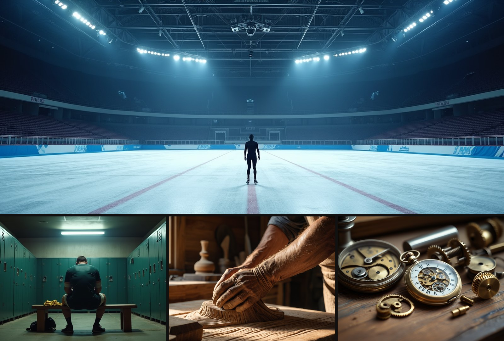

# ComfyUI workflows & tests

**Agustí Figueras** · AI filmmaker and art director · [Laia Media](https://laiamedia.com)

I spent 25 years in the art department of commercials and feature films. These are the ComfyUI workflows I work with and the tests behind them, all run locally on a MacBook Pro M4 Pro with 24 GB.

The workflows are deliberately simple. What I care about is method: lock everything, change one variable, look at the result the way I'd look at a set, and write down what it means on a real production.

## Workflows

| | Workflow | Model | What it's for |
|---|---|---|---|
| 01 | [FLUX.1 dev on Apple Silicon](workflows/01_flux-dev-gguf-mac) | FLUX.1 [dev] · Q5_K_S GGUF | Base text-to-image in a 2.35:1 scope frame |
| 02 | [SDXL base](workflows/02_sdxl-juggernaut-base) | Juggernaut XI | Base text-to-image with a working negative prompt |
| 03 | [SDXL film texture](workflows/03_sdxl-film-texture) | Juggernaut XI | Grain, halation and aberration that actually show up |

## Tests

| | Test | Finding |
|---|---|---|
| 01 | [FLUX samplers](tests/01_flux-samplers) | The deterministic samplers land on the same frame; ancestral and SDE ones drift. |
| 02 | [FLUX schedulers](tests/02_flux-schedulers) | karras and exponential leave FLUX images unfinished. Stay on simple. |
| 03 | [SDXL CFG ladder](tests/03_sdxl-cfg) | Start at CFG 7 on Juggernaut; from ~12 up, materials fuse. |
| 04 | [SDXL prompt weights](tests/04_sdxl-prompt-weights) | Film texture needs weights of 1.3–1.4. Fine geometry needs ControlNet, not prompting. |

## How to use

1. Drag a `.json` file onto the ComfyUI canvas.
2. Download the models below into your `ComfyUI/models` folders.
3. If a node shows up red, install the missing custom node with ComfyUI Manager.
4. After adding models or nodes, restart ComfyUI completely. A browser refresh doesn't reload the model folders.

## Models

| File | Folder | Source |
|---|---|---|
| `flux1-dev-Q5_K_S.gguf` | `models/unet` | [city96/FLUX.1-dev-gguf](https://huggingface.co/city96/FLUX.1-dev-gguf) · needs the [ComfyUI-GGUF](https://github.com/city96/ComfyUI-GGUF) custom node |
| `t5xxl_fp8_e4m3fn.safetensors` · `clip_l.safetensors` | `models/text_encoders` (older installs: `models/clip`) | [comfyanonymous/flux_text_encoders](https://huggingface.co/comfyanonymous/flux_text_encoders) |
| `ae.safetensors` | `models/vae` | [black-forest-labs/FLUX.1-dev](https://huggingface.co/black-forest-labs/FLUX.1-dev) (gated: accept the license first) |
| Juggernaut XI (`Juggernaut-XI-byRunDiffusion.safetensors` in my setup) | `models/checkpoints` | [RunDiffusion · Juggernaut XI](https://huggingface.co/RunDiffusion/Juggernaut-XI-v11) |

FLUX.1 [dev] weights are released under Black Forest Labs' FLUX.1 [dev] Non-Commercial License. Check each model's license before using it commercially.

## Next

ControlNet, inpainting and my own LoRAs: the tools for the structural problems these tests kept running into.

---

[Portfolio](https://agustifigueras.com) · [Vimeo](https://vimeo.com/user59416868) · [LinkedIn](https://www.linkedin.com/in/agusti-figueras)
