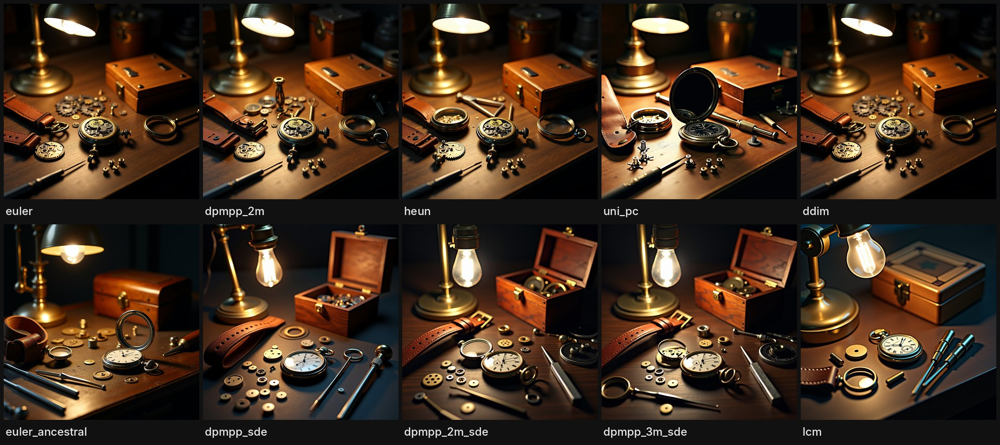

# Test 01 · FLUX samplers

**Question:** does the sampler change the image in a way a director would care about?

**Fixed:** FLUX.1 dev Q5_K_S GGUF · seed 482217 · 28 steps · scheduler simple · CFG 1.0 · FluxGuidance 3.5 · 1024 × 1024 · same prompt (a watchmaker's workbench still life).
**Changed:** only `sampler_name`. June 2026.

## What I see

- **euler, dpmpp_2m, heun, uni_pc and ddim** land on practically the same frame: same layout, same light. They're the reliable group, so I choose between them on speed (heun is the slow one: it runs the model twice per step).
- **euler_ancestral, dpmpp_sde, dpmpp_2m_sde and dpmpp_3m_sde** add fresh noise at every step, so the same seed gives a different picture. Fine for exploring, bad for continuity between shots.
- **lcm** is built for distilled few-step models. Here it drifts as well, and I discarded it.
- No sampler adds wear or atmosphere for free. Tarnish, oil stains and dust have to be written into the prompt.

## Takeaway

euler + simple as the default. To change the look, change the prompt, not the sampler.

Workflow: [01 · FLUX.1 dev on Apple Silicon](../../workflows/01_flux-dev-gguf-mac) with the sampler swapped.
