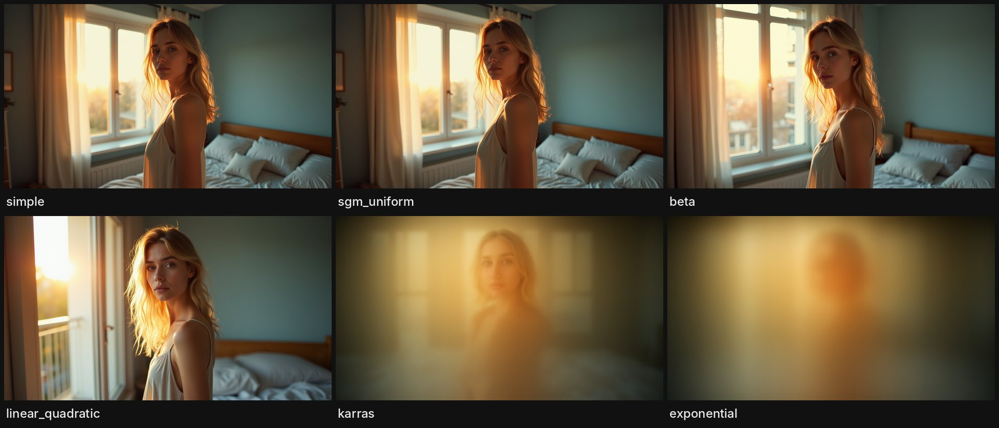

# Test 02 · FLUX schedulers

**Question:** which schedulers actually finish a FLUX image?

**Fixed:** FLUX.1 dev Q5_K_S GGUF · sampler euler · seed 568762976742769 · 24 steps · CFG 1.0 · FluxGuidance 3.5 · 1280 × 720 · same prompt.
**Changed:** only `scheduler`. June 2026. I repeated it with other subjects and got the same pattern.

## What I see

- **simple, sgm_uniform and beta** finish the image cleanly and almost identically.
- **linear_quadratic** finishes too, but reframes the shot (different window, tighter framing).
- **karras and exponential** never finish denoising at 24 steps: the frame stays a soft, foggy sketch.

My reading: karras and exponential are noise schedules built for classic diffusion models like SDXL, and they don't fit the way FLUX denoises.

## Takeaway

On FLUX, stay on simple (or sgm_uniform / beta). If a FLUX image comes out milky and unresolved, check the scheduler before touching the prompt.

Workflow: [01 · FLUX.1 dev on Apple Silicon](../../workflows/01_flux-dev-gguf-mac) with the scheduler swapped.
