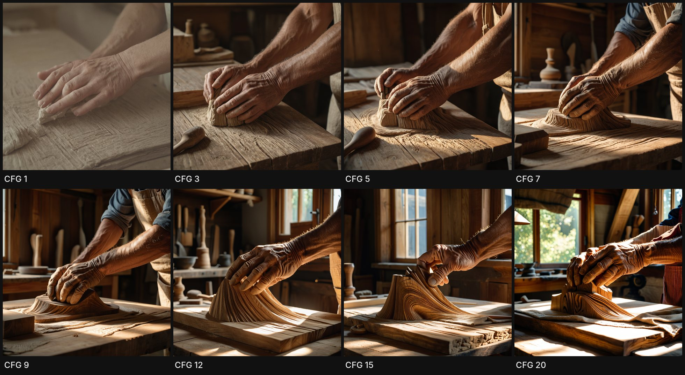

# Test 03 · SDXL CFG ladder

**Question:** where is the usable CFG window for Juggernaut XI, and what breaks on each side of it?

**Fixed:** Juggernaut XI · seed 584502784340658 · 25 steps · dpmpp_2m / karras · 1024 × 1024 · same prompt (a craftsman's hands carving wood).
**Changed:** only CFG, from 1 to 20. July 2026.

## What I see

- **CFG 1:** flat and washed out. The prompt barely steers the image.
- **Below 7:** the fingers deform when you look closely.
- **7–9:** the usable window. Light, wood grain and skin read naturally.
- **12 and up:** similar organic materials start to fuse. The carved wood turns into stringy fibres, skin and wood blend, and contrast gets harsh.
- **Hands holding a tool:** there's no fully clean window with this checkpoint. That's a model limit, so the fix is ControlNet, not CFG.
- **Steps:** going from 25 to 35 refines detail but doesn't fix anatomy.

## Takeaway

Start at CFG 7 on Juggernaut. The sweet spot moves with the checkpoint and with the prompt, so test it again on each project.

Workflow: [02 · SDXL base](../../workflows/02_sdxl-juggernaut-base) with CFG swapped.
