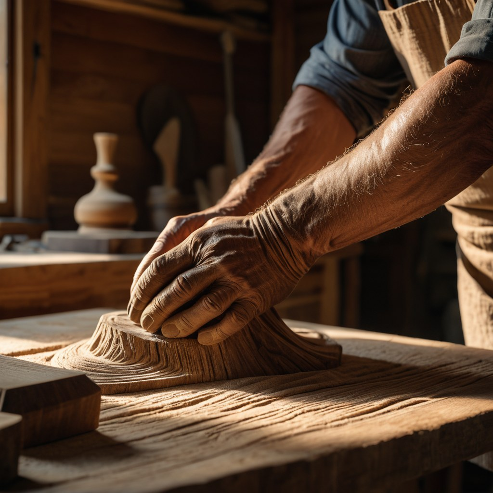

# 02 · SDXL base (Juggernaut XI)

My base SDXL text-to-image: the standard ComfyUI graph, tuned through the [CFG ladder test](../../tests/03_sdxl-cfg). The image above was generated with these exact settings.

**File:** [`sdxl-juggernaut-base.json`](sdxl-juggernaut-base.json)

| Setting | Value |
|---|---|
| Checkpoint | Juggernaut XI |
| Frame | 1024 × 1024 |
| Sampler / scheduler | dpmpp_2m / karras |
| Steps | 25 |
| CFG | 7 |
| Seed | 584502784340658, fixed |

## Notes from practice

- SDXL wants comma-separated clauses, not prose, and the negative prompt does real work here (unlike FLUX at CFG 1).
- The CFG sweet spot isn't universal: it moves with the checkpoint and with the prompt. Prompt vocabulary and weight syntax do carry over between SDXL checkpoints.
- In my tests on Apple Silicon, the VAE baked into Juggernaut and `sdxl-vae-fp16-fix` gave pixel-identical images (checked with an MD5 hash and a numeric diff), so I don't load a separate VAE.

Model links are in the [main README](../../README.md#models).
